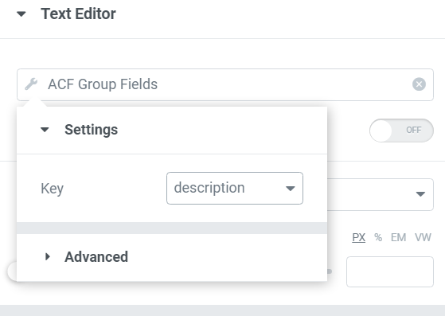

# Elementor ACF Group Fields

**Author:** Divine Elikplim Abah — [Hush User Xperience](https://github.com/deeveli) (Hush UX / HUX)  
**Version:** 2.0.0  
**Requires:** WordPress 5.8+, PHP 8.0+, Elementor, Elementor Pro, Advanced Custom Fields (Free or Pro)

Expose **nested** Advanced Custom Fields — Groups, Repeaters, Flexible Content, Clones, and every meaningful leaf type — as **Elementor Pro Dynamic Tags**, with unlimited practical nesting depth.



---

## Installation

1. Download or clone this repository into `wp-content/plugins/elementor-acf-group-fields`.
2. Optional: run `composer install --no-dev` (a built-in PSR-4 autoloader is used if `vendor/` is missing).
3. Activate **Elementor ACF Group Fields** in **Plugins**.
4. Ensure **Elementor**, **Elementor Pro**, and **ACF** are active.

### Upgrading from 1.x

- Dynamic tag names are preserved:
  - `acf_group_tag` (text)
  - `acf_group_image_tag` (image)
  - `acf_group_gallery_tag` (gallery)
- Existing Elementor templates that used those tags keep working.
- The legacy bootstrap file `elementor-extension-acf-group-tag.php` remains as a loader for older activations. Prefer the new main file `elementor-acf-group-fields.php` for new installs.

---

## Features

- Recursive discovery of **all** nested ACF fields (no hardcoded trees)
- Unlimited nesting: Group → Group → Group → … → any field
- First-class **Repeater** and **Flexible Content** support (with row index control)
- Correct **Clone** resolution with de-duplication
- Compound fields expanded into usable properties (Link URL/Title/Target, Image meta, File meta, etc.)
- Tag factory / registry — no copy-paste per field type
- Request + object-cache aware discovery
- PHP 8+, strict types, PSR-4, dependency-injected services
- Extensible via WordPress actions/filters

---

## Supported field types

| ACF type                                                | Dynamic tag kind   | Exposed properties                                                            |
| ------------------------------------------------------- | ------------------ | ----------------------------------------------------------------------------- |
| Text, Textarea, Number, Range, Email, Password, WYSIWYG | Text               | —                                                                             |
| Select, Checkbox, Radio, Button Group, True/False       | Text               | —                                                                             |
| Date / Date Time / Time Picker, Color Picker, oEmbed    | Text               | —                                                                             |
| URL                                                     | URL / Text         | URL string                                                                    |
| Link                                                    | URL / Text         | URL, Title, Target                                                            |
| Image                                                   | Image / URL / Text | Image, ID, URL, Alt, Caption, Description, Width, Height, Mime Type, Filename |
| File                                                    | Media / Text       | URL, Title, Filename, Size, Mime, Extension, ID                               |
| Gallery                                                 | Gallery            | Attachment IDs (Elementor Gallery widgets)                                    |
| Post Object / Page Link                                 | Text / URL         | ID, Title, Permalink, Slug, Excerpt, Featured Image, Author, Date             |
| Relationship                                            | Text / URL         | Titles, URLs, IDs                                                             |
| Taxonomy                                                | Text / URL         | Name, Slug, Description, Archive URL, ID                                      |
| User                                                    | Text / URL / Image | Display Name, Username, Email, Website, Avatar, ID                            |
| Google Map                                              | Text               | Address, Latitude, Longitude, Zoom                                            |
| Group                                                   | _(container)_      | Recurses into sub fields                                                      |
| Repeater                                                | _(container)_      | Recurses; use **Repeater / Flexible Row** control                             |
| Flexible Content                                        | _(container)_      | Every layout’s fields, recursively                                            |
| Clone                                                   | _(container)_      | Resolved referenced fields (deduped)                                          |
| Tab / Accordion / Message / Separator                   | _(skipped)_        | Layout-only                                                                   |

Future / unknown leaf types fall back to the text handler automatically.

---

## Architecture

```
elementor-acf-group-fields.php   # Main plugin bootstrap
elementor-extension-acf-group-tag.php  # Legacy loader (BC)
src/
  Autoloader.php
  Bootstrap.php                  # Dependency checks + boot
  Plugin.php                     # DI container / orchestrator
  Contracts/
    FieldTypeHandlerInterface.php
  Helpers/
    ACF.php                      # Cached ACF API wrappers
    Elementor.php                # Elementor Pro bridges
    Utils.php
  FieldTypes/                    # One handler per concern (Strategy)
    FieldTypeManager.php
    GroupField.php, RepeaterField.php, …
    TextField.php, ImageField.php, …
  Services/
    RecursiveWalker.php          # Unlimited recursive discovery
    FieldDiscovery.php           # Control option builder + cache
    FieldResolver.php            # Runtime value resolution
    FieldFormatter.php
    FieldDescriptor.php
    TagRegistry.php              # Tag factory registration
  Tags/
    TextTag.php                  # acf_group_tag
    ImageTag.php                 # acf_group_image_tag
    GalleryTag.php               # acf_group_gallery_tag
    UrlTag.php                   # acf_group_url_tag
    MediaTag.php                 # acf_group_media_tag
```

### Discovery flow

```
acf_get_field_groups()
        │
        ▼
RecursiveWalker::walk(field)
        │
        ├─ Group / Repeater / Flexible / Clone → recurse
        ├─ Layout-only → skip
        └─ Leaf → FieldDescriptor (+ property expansion)
                │
                ▼
        FieldDiscovery → Elementor SELECT groups
                │
                ▼
        TagRegistry → Text / Image / Gallery / URL / Media tags
```

---

## Usage examples

### Nested groups

```
Hero (Group)
 └── Button (Group)
      ├── Label (Text)
      └── Link  (Link)
```

In Elementor:

- **ACF Nested Fields** → `Hero → Button → Label`
- **ACF Nested URL / Link** → `Hero → Button → Link → URL`
- **ACF Nested Fields** → `Hero → Button → Link → Title`

### Nested repeaters

Set **Repeater / Flexible Row** to `1` for the first row, `2` for the second, and so on.

### Flexible Content

Layouts appear in the option label path, e.g. `Sections — Call to Action → Headline`.

---

## Screenshots

| #   | Description                                                                            |
| --- | -------------------------------------------------------------------------------------- |
| 1   | Dynamic tag picker showing nested ACF group fields _(see `preview.PNG`)_               |
| 2   | Image tag with nested group image _(placeholder — add `assets/screenshot-2.png`)_      |
| 3   | Gallery widget bound to nested gallery _(placeholder — add `assets/screenshot-3.png`)_ |
| 4   | Link field URL / Title / Target properties _(placeholder)_                             |
| 5   | Repeater row index control _(placeholder)_                                             |

---

## Developer notes

### Hooks

| Hook                             | Purpose                                                     |
| -------------------------------- | ----------------------------------------------------------- |
| `hux_eagf/register_field_types`  | Register custom `FieldTypeHandlerInterface` implementations |
| `hux_eagf/discovered_fields`     | Filter the list of `FieldDescriptor` objects                |
| `hux_eagf/control_options`       | Filter Elementor select option groups                       |
| `hux_eagf/should_register_field` | Skip specific fields during discovery                       |
| `hux_eagf/format_value`          | Alter formatted output                                      |
| `hux_eagf/tag_classes`           | Add/replace dynamic tag classes                             |
| `hux_eagf/leaf_types`            | Alter ACF types mapped to a tag kind                        |
| `hux_eagf/clone_fields`          | Alter resolved clone children                               |

### Extending with a custom field type

```php
add_action( 'hux_eagf/register_field_types', function ( $manager ) {
	$manager->register( new My\CustomAcfFieldHandler() );
} );
```

Implement `HushUX\ElementorAcfGroupFields\Contracts\FieldTypeHandlerInterface` (or extend `AbstractFieldType`).

### Coding standards

- PHP 8.0+ with `declare(strict_types=1);`
- PSR-4 namespace `HushUX\ElementorAcfGroupFields\`
- WordPress escaping/i18n conventions (`elementor-acf-group-fields` text domain)

---

## Testing

See **[TESTING.md](TESTING.md)** for the full manual QA checklist (nested groups, repeaters, flexible content, clone, gallery, relationship, maps, taxonomy, user, and more).

---

## Changelog

### 2.0.0 — Hush UX rewrite

- Complete object-oriented rewrite under Hush User Xperience (HUX)
- Recursive discovery for Group, Repeater, Flexible Content, Clone
- Broad ACF field coverage with property expansion
- New URL and Media dynamic tags
- Backwards-compatible tag names for text, image, and gallery
- Author: Divine Elikplim Abah (Hush UX)

### 1.0.0

- Original extension by Rodrigo Salles / Umair Ahmed — basic group text, image, and gallery tags

---

## License

GPL-2.0-or-later

## Credits

- Original concept: [roosalles/elementor-acf-group-fields](https://github.com/roosalles/elementor-acf-group-fields)
- Rewrite & architecture: **Divine Elikplim Abah** — Hush User Xperience (Hush UX / HUX)
